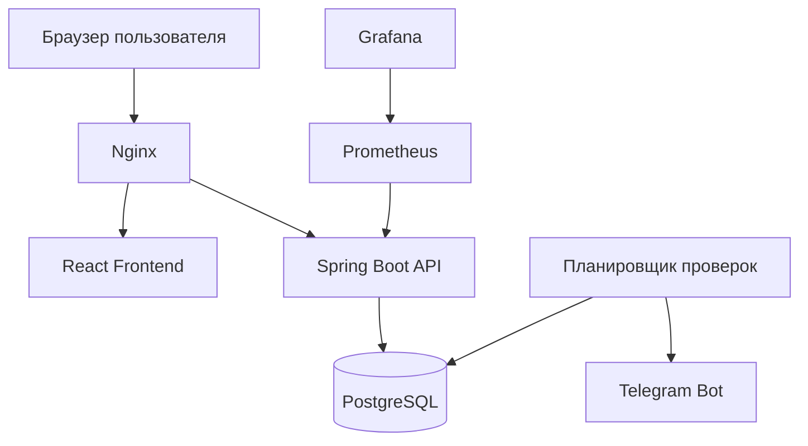

# Uptime Monitor

**Uptime Monitor** — система мониторинга доступности веб-сайтов, разработанная на Java, Spring Boot и React с использованием Docker, PostgreSQL, Prometheus и Grafana.

Приложение автоматически проверяет зарегистрированные сайты, сохраняет историю проверок, рассчитывает показатели доступности и отправляет уведомления в Telegram при изменении состояния сайта.

## Возможности

- Мониторинг доступности веб-сайтов.
- Автоматическая проверка сайтов каждые 60 секунд.
- Отслеживание HTTP-кодов и времени ответа.
- Определение статуса Online / Offline.
- Добавление и удаление сайтов.
- Сохранение истории проверок.
- Графики времени ответа.
- Расчёт процента доступности (Uptime).
- Общая панель мониторинга.
- Уведомления в Telegram при изменении статуса сайта.
- Сбор метрик с помощью Prometheus.
- Визуализация метрик в Grafana.
- REST API для взаимодействия с приложением.
- Запуск всей инфраструктуры через Docker Compose.
- Автоматическая сборка и публикация Docker-образа через GitHub Actions.
- Постоянное хранение данных в PostgreSQL.

## Используемые технологии

### Backend

- Java 25
- Spring Boot
- Spring Data JPA
- Spring Boot Actuator
- Maven
- PostgreSQL

### Frontend

- React
- TypeScript
- Vite
- Recharts
- Lucide React

### DevOps и мониторинг

- Docker
- Docker Compose
- Nginx
- Prometheus
- Grafana
- GitHub Actions
- Telegram Bot API

## Архитектура проекта



## Структура проекта

```text
uptime-monitor/
├── src/
│   └── main/
│       ├── java/
│       │   └── dev/uptime/monitor/
│       └── resources/
├── frontend/
│   ├── src/
│   │   ├── components/
│   │   └── App.tsx
│   ├── Dockerfile
│   ├── nginx.conf
│   └── package.json
├── prometheus.yml
├── docker-compose.yml
├── Dockerfile
├── .env.example
└── README.md
```

## Установка и запуск

### Требования

Для запуска проекта необходимы:

- Docker
- Docker Compose
- Git

### 1. Клонирование репозитория

```bash
git clone https://github.com/healthfase/uptime-monitor.git
cd uptime-monitor
```

### 2. Настройка переменных окружения

Создай файл `.env` в корневой директории проекта:

```env
DB_USERNAME=postgres
DB_PASSWORD=change_this_password

TELEGRAM_BOT_TOKEN=
TELEGRAM_CHAT_ID=
```

Укажи собственные учётные данные PostgreSQL.

Если Telegram-уведомления не используются, переменные Telegram можно оставить пустыми.

**Важно:** не публикуй файл `.env` и не добавляй его в GitHub, поскольку он содержит конфиденциальные данные.

### 3. Сборка и запуск приложения

```bash
docker compose up -d --build
```

### 4. Проверка запущенных контейнеров

```bash
docker compose ps
```

### 5. Просмотр логов приложения

```bash
docker compose logs -f app
```

## Адреса сервисов

| Сервис | Адрес |
|---|---|
| Frontend | http://localhost:5173 |
| Backend API | http://localhost:8080 |
| Prometheus | http://localhost:9090 |
| Grafana | http://localhost:3000 |

При первом запуске Grafana обычно предлагает использовать учётные данные `admin / admin` с последующей сменой пароля, если они не были изменены заранее.

## REST API

### Управление сайтами

| Метод | Endpoint | Описание |
|---|---|---|
| GET | `/api/sites` | Получение списка сайтов |
| GET | `/api/sites/{id}` | Получение информации о сайте |
| POST | `/api/sites` | Добавление нового сайта |
| DELETE | `/api/sites/{id}` | Удаление сайта |

### Мониторинг и статистика

| Метод | Endpoint | Описание |
|---|---|---|
| GET | `/api/check?url=...` | Проверка доступности URL |
| GET | `/api/dashboard` | Получение общей статистики |
| GET | `/api/sites/{id}/history` | Получение истории проверок |
| GET | `/api/sites/{id}/statistics` | Получение статистики сайта |

### Пример добавления сайта

```bash
curl -X POST http://localhost:8080/api/sites \
  -H "Content-Type: application/json" \
  -d '{"url":"https://example.com","name":"Example"}'
```

### Пример получения общей статистики

```bash
curl http://localhost:8080/api/dashboard
```

### Пример получения истории проверок

```bash
curl "http://localhost:8080/api/sites/1/history?limit=50"
```

## Мониторинг приложения

### Prometheus

Prometheus собирает метрики приложения через Spring Boot Actuator:

```text
http://app:8080/actuator/prometheus
```

Собираемые метрики включают показатели JVM, HTTP-запросов и пользовательские метрики мониторинга сайтов.

### Grafana

Grafana используется для визуализации собранных метрик.

С помощью дашбордов можно отслеживать:

- Использование CPU.
- Использование памяти JVM.
- Время работы приложения.
- Количество HTTP-запросов.
- Время обработки запросов.
- Количество зарегистрированных сайтов.
- Количество доступных и недоступных сайтов.
- Статистику проверок.

## Telegram-уведомления

Приложение поддерживает отправку уведомлений в Telegram при изменении состояния отслеживаемого сайта.

Для настройки необходимо указать:

- `TELEGRAM_BOT_TOKEN` — токен Telegram-бота.
- `TELEGRAM_CHAT_ID` — идентификатор чата.

Переменные задаются в файле `.env`.

## CI/CD

Для автоматизации сборки используется GitHub Actions.

Pipeline выполняет следующие задачи:

1. Запуск автоматических тестов Maven.
2. Сборка Docker-образа приложения.
3. Публикация Docker-образа в Docker Hub.

**GitHub:**

https://github.com/healthfase/uptime-monitor

**Docker Hub:**

https://hub.docker.com/r/healthfase/uptime-monitor

## Хранение данных

Docker Compose использует именованные volumes:

- `postgres_data` — данные PostgreSQL.
- `prometheus_data` — данные Prometheus.
- `grafana_data` — данные Grafana.

Volumes позволяют сохранять данные при перезапуске и пересоздании контейнеров.

## Локальная разработка

### Запуск тестов Backend

```bash
./mvnw clean verify
```

### Установка зависимостей Frontend

```bash
cd frontend
npm install
```

### Запуск Frontend в режиме разработки

```bash
npm run dev
```

### Production-сборка Frontend

```bash
npm run build
```

## Планы по развитию

- Развёртывание приложения на VPS.
- Настройка HTTPS и обратного прокси.
- Автоматизация развёртывания с помощью Ansible.
- Контейнерная оркестрация с помощью Kubernetes.
- Автоматическое резервное копирование базы данных.
- Расширение системы уведомлений и мониторинга.

## Автор

**healthfase**

GitHub: https://github.com/healthfase
